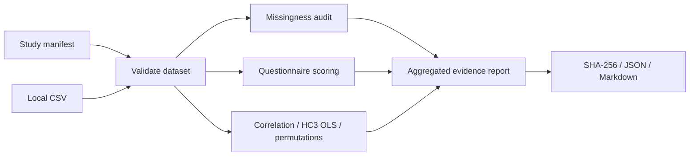

# 🧪 Study Sentinel

**From behavioral-study CSVs to inspectable research evidence — offline, reproducible, and honest about assumptions.**

Study Sentinel is a Python workbench for researchers who need to understand whether a questionnaire dataset is internally consistent *before* interpreting correlations or regression coefficients. Provide a study manifest and CSV; it checks participant IDs and response ranges, reports missingness, scores reverse-coded questionnaire items, calculates reliability, fits statistical models, and writes aggregate Markdown/JSON evidence files with the input SHA-256 checksum.

> **Prototype / research software.** Not a clinical tool, validated psychometric instrument, causal-inference engine, or substitute for a statistician. Generated demo results do **not** represent real human data.

## Why this exists

A single `p < 0.05` rarely tells you whether questionnaire scoring, missing values, participant independence, or the analyzed data version are trustworthy. Study Sentinel keeps these concerns close to the statistical output, instead of making them an afterthought.

## Two-minute local quickstart

Requires Python 3.10+ and internet access once to install Python dependencies. No GPU, cloud API key, or personal data required.

```bash
python -m pip install -e '.[api,test]'
study-sentinel demo --out demo-study --n 300 --seed 42
study-sentinel analyze --manifest demo-study/study.json --csv demo-study/synthetic_study.csv --out demo-report
python -m pytest -q
```

Generated files:

- `demo-study/study.json`: input and scoring contract
- `demo-study/synthetic_study.csv`: artificial participant-like records
- `demo-report/report.json`: machine-readable statistics, missingness and SHA-256 provenance
- `demo-report/report.md`: human-readable results and cautions

Run the **synthetic-only** HTTP demo locally:

```bash
uvicorn study_sentinel.api:app --host 127.0.0.1 --port 8000
curl http://127.0.0.1:8000/health
```

Swagger interface: `http://127.0.0.1:8000/docs`

## Workflow



## Features and scientific boundaries

| Capability | Implemented | Interpretation caveat |
| --- | --- | --- |
| Unique participant IDs, missing tokens, valid item ranges | Yes | Cannot detect all fabricated or dependent observations |
| Missingness and complete-case counts | Yes | Missing-data mechanism is not inferred |
| Mean scale scores and reverse coding | Yes | Scoring must match an externally validated instrument |
| Cronbach alpha | Yes | Not proof of validity or unidimensionality |
| Pearson correlation with confidence interval | Yes | Observational, not causal |
| OLS coefficients with HC3 robust SE | Yes | Model specification and assumptions remain researcher responsibility |
| Seeded permutation correlation | Yes | Exchangeability needed |
| Source SHA-256, aggregate JSON/Markdown reports | Yes | Provenance is not cryptographic signing |
| Dedicated multiuser UI and access control | No | API is a local synthetic demonstration only |
| Longitudinal and causal inference | No | Planned only |

## Repository tour

```text
src/study_sentinel/
  contracts.py        # typed study manifest and questionnaire contract
  io.py               # bounded, validated local CSV ingest
  quality.py          # aggregate missingness and data-quality summaries
  psychometrics.py    # scoring, reversed items, coefficient alpha
  statistics.py       # correlation, HC3 OLS, permutation testing
  pipeline.py         # orchestrates the evidence workflow
  reports.py          # local aggregate evidence export
  simulation.py       # synthetic teaching data
  api.py              # optional synthetic-only FastAPI service
  cli.py              # reproducible CLI
tests/                # unit, API, numerical and end-to-end checks
docs/                 # architecture, reproducibility, API, next steps
scripts/count_loc.py  # reproducible first-party source count
```

## Security and privacy

No raw participant rows or IDs are intentionally included in generated reports. That does **not** make outputs safe to share automatically: summary statistics and small subgroups may still reveal information. The CLI uses local filesystem access; keep actual study data outside public repos and CI. The optional API does not provide secure multi-tenant authentication. See [SECURITY.md](SECURITY.md).

## Benchmarks, coverage and limits

CI results are visible in [GitHub Actions](https://github.com/aradmanamnaoon/study-sentinel/actions). The first version is a functional prototype, **not** a finished 10,000-line flagship. Execute `python scripts/count_loc.py` for the verified count; the script excludes tests, docs, fixtures and non-substantive blank/comment-only lines. Numerical values from synthetic demonstrations are illustrative, not empirical psychology results. Repository-based CI verifies running code, not research validity.

## Project resources

- [Architecture](docs/ARCHITECTURE.md)
- [API contract](docs/API.md)
- [Reproducibility](docs/REPRODUCIBILITY.md)
- [Continuation backlog](docs/CONTINUATION.md)
- [Security](SECURITY.md)
- [Contributing](CONTRIBUTING.md)
- [Code of conduct](CODE_OF_CONDUCT.md)
- [Changelog](CHANGELOG.md)

**License:** MIT for first-party code. Third-party dependencies retain their own licenses.

## Cite

If referring to this prototype in scholarly work, include the repository URL and an immutable commit SHA. No research-paper citation or DOI is assigned at present.
