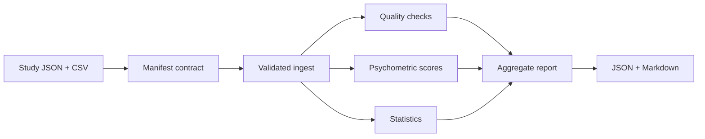

# Architecture

The CLI calls `contracts`, `io`, `pipeline`, and `reports`. The API is a separate synthetic-data-only demonstration, not a raw-data uploading platform. All analysis executes in the local Python process. There is no remote persistence, account system, or asynchronous job queue.

## Data contracts

JSON manifest: `name`, `id_column`, `outcome`, `exposure`, optional `covariates`, `scales`, `seed`, and `missing_tokens`. Each scale specifies `name`, `items`, optional reverse-coded columns, lower/upper valid range, and minimum answered items. Inputs must be UTF-8 CSV with unique participant IDs and valid numeric fields. The exact CSV bytes are SHA-256 hashed.

## Threats

CSV formula cells are not executed by pandas. Input files are bounded to 100 MiB. Reports are aggregate only, but rare-event summaries and model outputs may still disclose sensitive information; users must not treat these safeguards as anonymization. The API is bound to loopback only when run using the recommended command. No authorization or remote service is supplied.

## Statistics

Independent-row assumption, exchangeability for the permutation statistic, and complete-case assumptions require expert scrutiny. HC3 uses asymptotic normal p-values. Coefficient alpha is not equivalent to scale validity. No correction for multiple comparisons is implemented.
